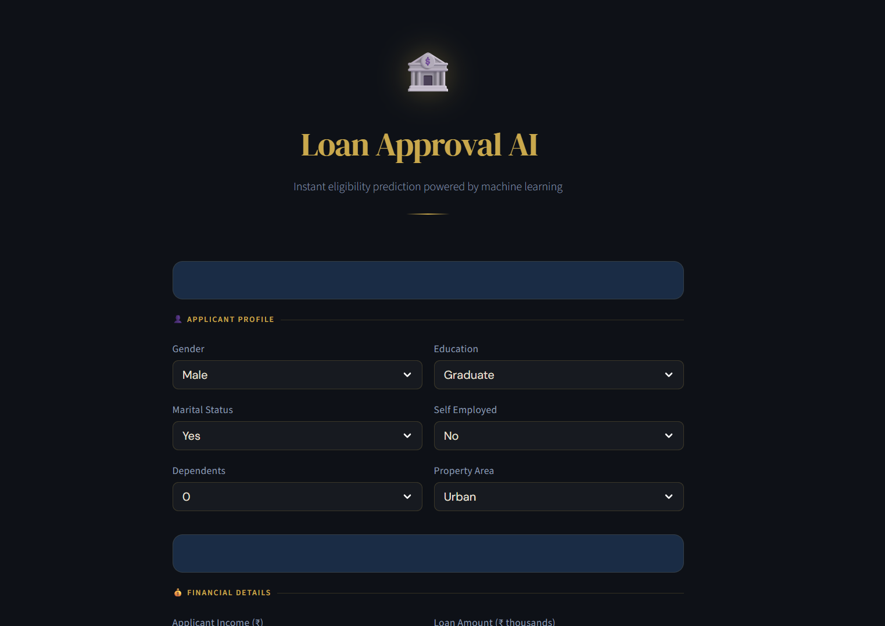

# 🏦 Loan Approval AI — End-to-End ML Project

🚀 **Live Demo:** https://loan-prediction-ml-kamivinnu.streamlit.app/
📌 **Status:** Production-ready ML Web App

---

## 📸 App Preview



---

## 📌 Overview

This project predicts whether a loan application will be **Approved or Rejected** using Machine Learning.

It covers the complete pipeline:

* Data Cleaning
* Exploratory Data Analysis (EDA)
* Feature Engineering
* Model Building & Evaluation
* Deployment using Streamlit

---

## 🎯 Objective

* Predict loan approval status
* Identify key factors influencing approval
* Build a real-world ML application
* Deploy an interactive web app

---

## 📊 Dataset

* Loan Prediction Dataset
* 614 rows × 13 features
* Target Variable: `Loan_Status`

---

## ⚙️ Workflow

### 🔹 Data Cleaning

* Dropped `Loan_ID`
* Handled missing values:

  * Mode → categorical features
  * Median → numerical features

---

### 🔹 Exploratory Data Analysis (EDA)

* Loan approval distribution analysis
* Feature vs target relationships
* Identified key influencing variables

---

### 🔹 Feature Engineering ⭐

* `Total_Income = ApplicantIncome + CoapplicantIncome`
* `Loan_Income_Ratio = LoanAmount / Total_Income`

👉 These improved model understanding of financial strength

---

### 🔹 Model Building

Trained multiple models:

* Logistic Regression ✅ (Best)
* Decision Tree
* Random Forest
* XGBoost

---

### 🔹 Model Evaluation

Metrics used:

* Accuracy
* Precision
* Recall
* F1 Score

📈 **Best Model: Logistic Regression**

* Accuracy: ~79%
* F1 Score: ~0.86
* Recall: ~0.99

---

## 💡 Key Insights

* 💳 Credit History is the most important factor
* 💰 Income alone does not guarantee approval
* 👥 Coapplicant income has low impact
* 💍 Married applicants have slightly higher approval

---

## 🧠 ML Highlights

* End-to-end pipeline
* Feature engineering
* Model comparison
* Real-world problem solving

---

## 🚀 Streamlit Web App

Users can:

* Enter applicant details
* Get instant loan approval prediction
* View confidence score

---

## 🛠️ Tech Stack

* Python
* Pandas, NumPy
* Scikit-learn
* XGBoost
* Streamlit

---

## 📁 Project Structure

```
Loan-Prediction/
│
├── loan_prediction.ipynb
├── loan_model.pkl
├── scaler.pkl
├── app.py
├── requirements.txt
├── README.md
```

---

## ▶️ How to Run Locally

```bash
# Clone repository
git clone https://github.com/your-username/loan-prediction.git

# Move to folder
cd loan-prediction

# Install dependencies
pip install -r requirements.txt

# Run app
streamlit run app.py
```

---

## 🌐 Deployment

This app can be deployed easily on:

* Streamlit Cloud (Recommended)
* Render
* Railway

---

## 🔮 Future Improvements

* Hyperparameter tuning
* Advanced models (LightGBM, CatBoost)
* Model pipeline integration
* Better explainability (SHAP, feature importance)

---

## 🏆 Conclusion

Logistic Regression performed best, indicating the dataset is relatively simple and structured.
Feature engineering significantly improved prediction capability.

---

## ⭐ If you like this project

Give it a ⭐ on GitHub!
